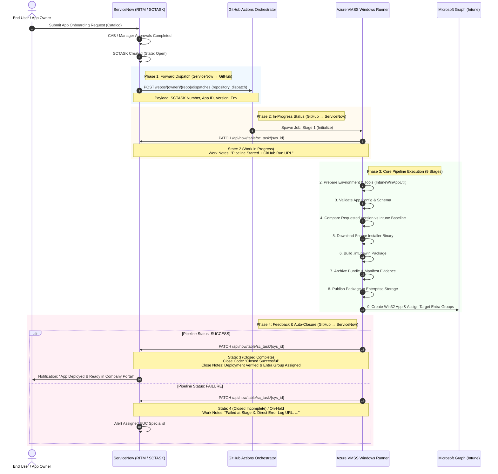

# Intune App Factory – Replatformed Architecture & ServiceNow Bi-Directional Integration

> **Enterprise CI/CD Automation Framework for Zero-Touch Application Packaging (.intunewin), Microsoft Intune Deployment, and ServiceNow SCTASK Closed-Loop Lifecycle Management.**

---

## 📋 Executive Overview (Client & Architecture Summary)

In enterprise IT endpoint management, traditional application onboarding suffers from:
- **Manual, slow hand-offs**: Packaging requests sit idle in ITSM queues.
- **Disconnected toolchains**: Engineers manually package binaries using `IntuneWinAppUtil.exe` on desktop machines.
- **Compliance gaps**: Lack of audit linkage between ServiceNow tickets, GitHub commits, build artifacts, and deployed Intune applications.

**Intune App Factory** replatforms this workflow into a **fully automated, bi-directional, event-driven CI/CD ecosystem**:
1. **ServiceNow $\to$ GitHub Actions**: Approval of a Service Catalog task (`SCTASK`) automatically dispatches a parameterized pipeline.
2. **GitHub Actions $\to$ ServiceNow**: The pipeline acknowledges the ticket, transitions it to *Work in Progress*, streams run links to Work Notes, and **auto-closes** the ticket upon deployment verification (or flags errors with failure diagnostics).
3. **Enterprise Scalability**: Powered by reusable workflows, configuration-driven YAML manifests, Azure VM Scale Set (VMSS) self-hosted Windows runners, and Microsoft Entra ID Workload Identity (OIDC).

---

## 🏛️ System Architecture Topology

```
                  ┌────────────────────────────────────────────────────────┐
                  │              Application Source Repositories           │
                  │  - vCME VM  - AWS DFS FileShares  - GitHub  - Azure Blob│
                  └───────────────────────────┬────────────────────────────┘
                                              │
                                              ▼
┌─────────────────────────────────────────────────────────────────────────────────────────────┐
│                                    GitHub Actions Automation                                │
│                                                                                             │
│  .github/workflows/application.yml  ──────►  .github/workflows/reusable-application.yml     │
│  (Main Dispatch & App Discovery)             (Reusable 9-Stage Pipeline)                    │
│                                                                                             │
│    ┌──────────────┬──────────────┬──────────────┬──────────────┬──────────────┐             │
│    │ 1.Initialize │ 2. Prepare   │ 3. Validate  │ 4. Compare   │ 5. Download  │             │
│    └──────┬───────┴──────┬───────┴──────┬───────┴──────┬───────┴──────┬───────┘             │
│           │              │              │              │              │                     │
│           ▼              ▼              ▼              ▼              ▼                     │
│    ┌──────────────┬──────────────┬──────────────┬──────────────┐                            │
│    │ 6. Build     │ 7. Archive   │ 8. Publish   │ 9. Assign    │                            │
│    └──────────────┴──────────────┴──────────────┴──────┬───────┘                            │
└────────────────────────────────────────────────────────┼────────────────────────────────────┘
                                                         │
         ┌───────────────────────────────────────────────┼────────────────────────────────┐
         │                                               │                                │
         ▼                                               ▼                                ▼
┌──────────────────────┐                     ┌──────────────────────┐         ┌──────────────────────┐
│ Microsoft Entra ID   │                     │ Azure Infrastructure │         │ ServiceNow ITSM      │
│ (OIDC Auth / WIF)    │                     │ - Azure Key Vault    │         │ - RITM / SCTASK      │
│                      │                     │ - Azure VMSS Runners │         │ - Flow Designer Hook │
│ Microsoft Graph API  │                     │ - Azure Monitor / LA │         │ - Bi-directional API │
│ (Intune Win32 Apps)  │                     │ - Azure Storage Blob │         │ - Auto-closure       │
└──────────────────────┘                     └──────────────────────┘         └──────────────────────┘
```

---

## 🔄 End-to-End Bi-Directional Sequence Flow



---

## ⚙️ Phase-by-Phase Technical Specifications

### Phase 1: Forward Dispatch (ServiceNow $\to$ GitHub Actions)
When an `SCTASK` enters the approved state, ServiceNow **Flow Designer** or an **Outbound REST Message** fires an HTTP webhook to GitHub:

* **Endpoint**: `POST https://api.github.com/repos/Deshthakur/intune-app-factory-replatformed/dispatches`
* **Headers**:
  ```http
  Accept: application/vnd.github+json
  Authorization: Bearer <GITHUB_ACTIONS_PAT_OR_APP_TOKEN>
  X-GitHub-Api-Version: 2022-11-28
  Content-Type: application/json
  ```
* **Payload**:
  ```json
  {
    "event_type": "servicenow_sctask_dispatch",
    "client_payload": {
      "sctask_number": "SCTASK0010924",
      "application": "app01-7zip",
      "environment": "DEV",
      "version": "23.01",
      "deployment_mode": "Standard"
    }
  }
  ```

---

### Phase 2: In-Progress Status & Audit Trail (GitHub $\to$ ServiceNow)
As soon as the runner picks up Stage 1 (`initialize`), it executes `scripts/servicenow/servicenow-integration.ps1 -Action "StartTask"`.

* **Endpoint**: `PATCH https://<instance>.service-now.com/api/now/table/sc_task/{sys_id}`
* **Payload**:
  ```json
  {
    "state": "2",
    "work_notes": "[GitHub Actions Dispatch]\nPipeline initiated for Intune App Factory deployment.\n- Application ID : app01-7zip\n- Environment    : DEV\n- Build ID       : app01-7zip-DEV-20261011-a8f1b2\n- Runner Host    : VMSS-WIN-RUNNER-04\n- Workflow Run   : https://github.com/Deshthakur/intune-app-factory-replatformed/actions/runs/38126197053\n- Timestamp      : 2026-10-13 18:00:00 UTC"
  }
  ```
* **Outcome**: The ticket status instantly moves to **Work in Progress**, eliminating orphan tickets.

---

### Phase 3: The 9-Stage Reusable Pipeline

| Stage | Name | Script Executed | Purpose |
|---|---|---|---|
| **1** | **Initialize** | `init-app.ps1` | Parses YAML config, generates unique Build ID, and updates SCTASK to *In Progress*. |
| **2** | **Prepare** | `prepare-env.ps1` | Sets up clean runner directories, verifies dependencies, and downloads `IntuneWinAppUtil.exe`. |
| **3** | **Validate** | `validate-config.ps1` | Validates YAML schema integrity, requirements, detection rules, and Key Vault connectivity. |
| **4** | **Compare** | `compare-version.ps1` | Evaluates requested version against Intune baseline; skips redundant work if already deployed. |
| **5** | **Download** | `fetch-source.ps1` | Pulls source installer from approved source (`direct_url`, `vcme_vm`, `aws_dfs`, or `azure_blob`). |
| **6** | **Build** | `build-app.ps1` | Executes `IntuneWinAppUtil.exe` to wrap the installer into enterprise `.intunewin` package. |
| **7** | **Archive** | `archive-artifact.ps1` | Generates auditable `.zip` evidence bundle containing `.intunewin`, `manifest.json`, and hashes. |
| **8** | **Publish** | `publish-package.ps1` | Uploads the packaged bundle into central enterprise Azure Storage Blob repository. |
| **9** | **Assign & Deploy**| `deploy-intune-vmss.ps1`| Uses Microsoft Graph API to publish Win32 app and assign Entra ID groups; closes SCTASK. |

---

### Phase 4: Auto-Closure & Error Handling (GitHub $\to$ ServiceNow)

#### Case A: Success Closure (`if: success()`)
Upon successful Graph API publication and group assignment:
* **Endpoint**: `PATCH https://<instance>.service-now.com/api/now/table/sc_task/{sys_id}`
* **Payload**:
  ```json
  {
    "state": "3",
    "close_code": "Closed Successful",
    "close_notes": "[Intune App Factory - Deployment Successful]\nApplication deployment completed and verified.\n- Application ID : app01-7zip\n- Environment    : DEV\n- Status         : Deployed & Assigned\n- Target Groups  : SG-Intune-App-7Zip-Required-DEV\n- Workflow Run   : https://github.com/Deshthakur/intune-app-factory-replatformed/actions/runs/38126197053",
    "work_notes": "Automated pipeline completion status: Successful. Closing SCTASK."
  }
  ```

#### Case B: Failure Alert (`if: failure()`)
If any stage fails (e.g., checksum mismatch or permission error):
* **Payload**:
  ```json
  {
    "state": "4",
    "close_code": "Closed Incomplete",
    "work_notes": "[Intune App Factory - Deployment Failed]\nApplication deployment encountered an error in the GitHub Actions pipeline.\n- Application ID : app01-7zip\n- Build ID       : app01-7zip-DEV-20261011-a8f1b2\n- Failure Reason : Stage 6 packaging failed. Inspect logs.\n- Direct Logs    : https://github.com/Deshthakur/intune-app-factory-replatformed/actions/runs/38126197053"
  }
  ```

---

## 🔒 Enterprise Security & Governance

1. **Zero Long-Lived Credentials (OIDC Workload Identity)**:
   - Runner connects to Microsoft Azure and Graph API using OpenID Connect (OIDC) JWT exchange (`azure/login@v2`). No client secrets are stored in GitHub.
2. **Dynamic Key Vault Secret Retrieval**:
   - Sensitive items like ServiceNow API tokens and private repository endpoints are fetched dynamically from **Azure Key Vault** at runtime.
3. **Least Privilege ServiceNow Role**:
   - The integration service identity requires only scoped table permissions (`sc_task` read & write for `state`, `work_notes`, `close_notes`). No administrative roles needed.
4. **End-to-End Audit Traceability**:
   - Every ServiceNow ticket contains the exact GitHub Actions Run URL.
   - Every GitHub Actions artifact contains `manifest.json` detailing runner host, operator, build ID, and timestamp.

---

## 📁 Repository Directory Structure

```
├── .github/
│   └── workflows/
│       ├── application.yml          # Main entrypoint: workflow_dispatch & repository_dispatch
│       └── reusable-application.yml # 9-stage modular reusable workflow
├── config/
│   ├── schema-app-config.json       # JSON Schema definition for app manifests
│   └── applications/
│       ├── app01-7zip.yml           # 7-Zip Enterprise Win32 config
│       ├── app02-vscode.yml         # VS Code Enterprise config
│       └── app03-github-repo.yml    # GitHub Release-backed app config
├── scripts/
│   ├── archive/archive-artifact.ps1
│   ├── assign/deploy-intune-vmss.ps1
│   ├── build/build-app.ps1
│   ├── common/azure-auth.ps1
│   ├── compare/compare-version.ps1
│   ├── download/fetch-source.ps1
│   ├── initialize/init-app.ps1
│   ├── prepare/prepare-env.ps1
│   ├── publish/publish-package.ps1
│   ├── servicenow/servicenow-integration.ps1 # Bi-directional ServiceNow helper
│   └── validate/validate-config.ps1
├── .gitignore
└── README.md
```

---

## 💡 Client & Architect Discussion Guide (Meeting Q&A)

### Q1: Why use GitHub Actions instead of orchestrating directly inside ServiceNow?
> **Answer**: ServiceNow is an ITSM system, not a CI/CD build engine. Compiling `.intunewin` binaries requires a dedicated Windows runtime (`IntuneWinAppUtil.exe`), file system manipulation, checksum verification, and network access to file shares. GitHub Actions with Azure VMSS Windows runners provides scalable compute, version-controlled workflows, and native developer tooling, while ServiceNow remains the system of record for approvals and change governance.

### Q2: What happens if ServiceNow is temporarily unreachable when GitHub Actions finishes?
> **Answer**: In `scripts/servicenow/servicenow-integration.ps1`, REST calls are wrapped in robust error handling with retries. If ServiceNow is offline, the build artifact and logs remain safely stored in GitHub Actions for 30 days, and an alert is flagged without failing the deployed Intune application.

### Q3: How do we test this without impacting production ServiceNow?
> **Answer**: The PowerShell script has a built-in `-DryRun` switch. In Dry-Run mode, all ServiceNow REST calls are simulated and logged to the console without mutating any real ServiceNow records.

### Q4: Can this framework handle 30+ applications without copying workflow files?
> **Answer**: Yes. This is a configuration-driven architecture. The pipeline logic is completely decoupled into `reusable-application.yml`. To add a new application, engineers only create a single YAML file (e.g. `config/applications/app31-slack.yml`) without touching workflow code.

---

## 🧪 Quick Start & Local Dry-Run Testing

You can test the ServiceNow integration script locally using PowerShell:

```powershell
# 1. Test Task Start (Simulates updating SCTASK to 'Work in Progress')
.\scripts\servicenow\servicenow-integration.ps1 `
  -Action "StartTask" `
  -TaskNumber "SCTASK0012345" `
  -AppId "app01-7zip" `
  -Environment "DEV" `
  -BuildId "build-test-101" `
  -DryRun

# 2. Test Task Auto-Closure (Simulates updating SCTASK to 'Closed Complete')
.\scripts\servicenow\servicenow-integration.ps1 `
  -Action "CloseTask" `
  -TaskNumber "SCTASK0012345" `
  -AppId "app01-7zip" `
  -Environment "DEV" `
  -BuildId "build-test-101" `
  -Status "Successful" `
  -DryRun
```
